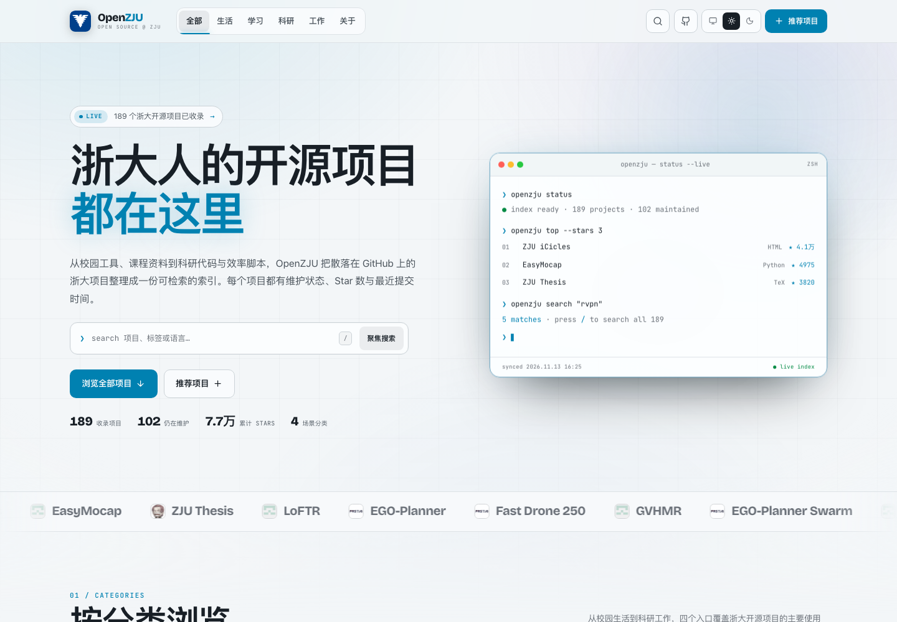
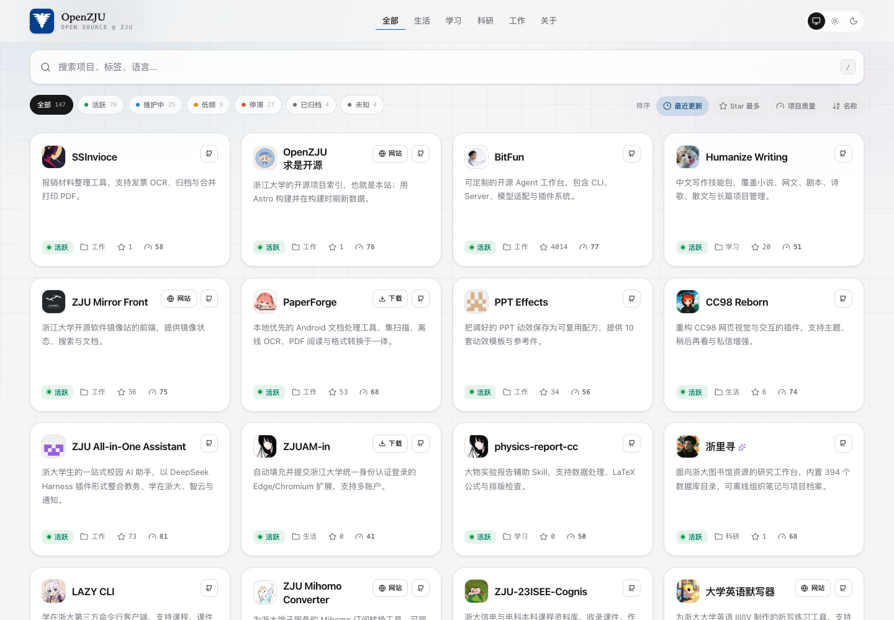

<div align="center">
  
  <h1>OpenZJU</h1>
  <p>A searchable map of open source projects from Zhejiang University.</p>

  <p>
    <a href="./LICENSE"></a>
    
    
    
    
  </p>

  <p>
    <a href="./README.md">简体中文</a> ·
    <a href="./docs/README.md">Docs</a> ·
    <a href="#quick-start">Quick start</a> ·
    <a href="#license">License</a>
  </p>
</div>

---

## Why this exists

Zhejiang University produces a large number of open source projects every year: course materials, research code, campus tools, productivity scripts, templates and curated resource lists. They are scattered across many organizations and personal repositories. Many overlap, and many are no longer maintained.

**OpenZJU** is a continuously refreshed index that helps you:

- check whether someone has already built what you are about to build;
- see whether a project is still maintained before depending on it;
- find course materials, campus tools and research code by category and tag.

The site does not host code and does not rank projects. It collects entry points and surfaces observable GitHub maintenance signals.

## Features

- **Four categories**: Life, Study, Research and Work.
- **Build-time GitHub sync**: stars, language, license, archived state, latest commit date and commits in the last 90 days.
- **Maintenance status**: active, maintained, low frequency, dormant and archived. Archived repositories sink to the bottom.
- **Code-quality-led audit**: a 0–100 score button in each card's status row opens the details, led by the daily deep static analysis (complexity, duplication, lint, secrets and dependency vulnerabilities). Repositories without analyzable source fall back to engineering signals, and the popover includes a heuristic AI-risk label.
- **Static search**: match names, descriptions, tags, categories, languages and licenses entirely in the browser.
- **Composable filters**: maintenance status, sort by recent activity / stars / name, with URL state.
- **Tags as entry points**: click a tag to search for it.
- **Light / dark / system themes**: follows the system by default and remembers explicit choices.
- **Swup page transitions**: no full-page flash, with accessibility, head updates and scroll handling preserved.
- **Responsive grid**: global scrolling and adaptive columns from mobile to wide screens.
- **Accessibility**: skip link, keyboard shortcuts, focus management, live result counts and reduced-motion support.
- **Resilient data**: when GitHub is unavailable or rate-limited, the build falls back to the last successful snapshot for repository stats, audits and code quality.
- **Daily deep analysis**: a GitHub Actions job runs static analysis every day, commits the cached metrics and keeps the Vercel build fast.

## Preview

| Light                                            | Dark                                           |
| ------------------------------------------------ | ---------------------------------------------- |
|  |  |

| Catalog                                             | Category page                                          |
| --------------------------------------------------- | ------------------------------------------------------ |
|  |  |

## Quick start

### Requirements

- Node.js **>= 22.23.4** (24 LTS recommended)
- pnpm **>= 11**

### Development

```bash
pnpm install
cp .env.example .env
pnpm dev
```

Open `http://localhost:4321`.

`GITHUB_TOKEN` is optional locally. Without it, the sync script uses the unauthenticated GitHub API or the existing cache. With a token, you get complete commit-frequency data and a much higher rate limit.

### Build

```bash
pnpm build
```

The build:

1. runs `scripts/sync-projects.ts` to refresh GitHub repository stats into `src/generated/repository-stats.json`;
2. runs `scripts/sync-audits.ts` to refresh engineering signals and OpenSSF Scorecard results, and to merge `repository-code-quality.json` into `src/generated/repository-audits.json`;
3. statically generates the home page, four category pages, about page, 404 page, `robots.txt` and the sitemap;
4. writes the result to `dist/`.

Deep static analysis does not run in the Vercel build. It runs daily in [`.github/workflows/deep-audit.yml`](./.github/workflows/deep-audit.yml), commits the cache and triggers deployment. Run it once manually after the first deployment. See [`docs/code-quality.md`](./docs/code-quality.md) (Chinese) for tools, scoring and limitations.

To skip network requests and use the checked-in cache:

```bash
SKIP_GITHUB_SYNC=1 pnpm build
```

## Add a project

All project metadata lives in [`src/data/projects.ts`](./src/data/projects.ts). Add one record:

```ts
{
  slug: "my-zju-project",
  name: "My ZJU Project",
  description: "One sentence explaining what this project solves.",
  repo: "owner/repo",
  category: "study",
  tags: ["course", "tool"],
  links: {
    website: "https://example.com",
    download: "https://example.com/download",
  },
}
```

| Field            | Required | Notes                                  |
| ---------------- | -------- | -------------------------------------- |
| `slug`           | yes      | Unique lowercase kebab-case            |
| `name`           | yes      | Display name                           |
| `description`    | yes      | At least 16 characters                 |
| `repo`           | yes      | GitHub repository in `owner/name` form |
| `category`       | yes      | `life`, `study`, `research` or `work`  |
| `tags`           | yes      | At least one, preferably 2–4           |
| `links.website`  | no       | Deployed site or project page          |
| `links.download` | no       | Download or releases page              |
| `featured`       | no       | Shows an editor's pick marker          |

`slug` must be unique, and `repo` must be unique when present. Projects without a GitHub repository can still be listed if they have a website or download link. Projects are validated at build time by [`validateProjects`](./src/domain/project/project.ts); duplicates, missing fields or invalid URLs fail the build.

## Maintenance status

| Status        | Rule                                                   |
| ------------- | ------------------------------------------------------ |
| Active        | A commit on the default branch within the last 90 days |
| Maintained    | A commit within the last year                          |
| Low frequency | Last commit between one and two years ago              |
| Dormant       | No commits for more than two years                     |
| Archived      | The GitHub repository is archived                      |
| Unknown       | No repository activity data is available               |

These are automated signals, not a quality score or a production-readiness guarantee.

## Project structure

```text
.
├── .github/
│   ├── ISSUE_TEMPLATE/          # project suggestion form
│   └── workflows/               # CI and scheduled deployment
├── docs/                        # architecture, data, design, deployment, development
├── public/                      # favicon, OG image, manifest
├── scripts/
│   ├── deep-audit/              # daily deep static analysis scripts
│   ├── sync-audits.ts           # build-time audit sync entry
│   └── sync-projects.ts         # build-time GitHub sync entry
├── src/
│   ├── application/             # catalog assembly, search, sorting
│   ├── config/                  # site configuration
│   ├── data/                    # project source data
│   ├── domain/                  # project, category, maintenance rules
│   ├── generated/               # repository stats, audit and code quality caches
│   ├── infrastructure/          # GitHub / OpenSSF clients and code quality storage
│   ├── pages/                    # Astro routes
│   └── presentation/            # Astro views, styles and browser controllers
├── astro.config.mjs
├── biome.json
├── package.json
├── tsconfig.json
└── vercel.json
```

The codebase follows DDD + MVC:

- **Domain** — entities and rules with no Astro or Node dependency.
- **Application** — pure catalog assembly, statistics, search and sorting.
- **Infrastructure** — GitHub GraphQL / REST / Atom sync and cache I/O.
- **Presentation** — Astro views, design system and browser controllers.

Read [`docs/architecture.md`](./docs/architecture.md) for the details. The documentation itself is written in Chinese.

## Scripts

| Command                      | Description                           |
| ---------------------------- | ------------------------------------- |
| `pnpm dev`                   | Start the Astro dev server            |
| `pnpm build`                 | Sync GitHub data and build statically |
| `pnpm preview`               | Preview the production build          |
| `pnpm sync:projects`         | Refresh GitHub repository stats       |
| `pnpm sync:projects:offline` | Use the local cache only              |
| `pnpm sync:audits`           | Refresh project audits                |
| `pnpm sync:audits:offline`   | Use the audit cache only              |
| `pnpm deep:prepare`          | Prepare deep-audit chunks             |
| `pnpm deep:analyze`          | Analyze one chunk                     |
| `pnpm deep:merge`            | Merge deep-audit results              |
| `pnpm check`                 | `astro check` + Biome                 |
| `pnpm check:ci`              | Strict CI check                       |
| `pnpm format`                | Format with Biome                     |
| `pnpm lint`                  | Lint with Biome                       |
| `pnpm test`                  | Run Vitest unit tests                 |

## Build-time GitHub sync

The sync implementation lives in [`src/infrastructure/github`](./src/infrastructure/github):

1. With `GITHUB_TOKEN`, use batched GraphQL queries first.
2. Fall back to REST repository metadata and the last 90 days of commits.
3. If the commits API is unavailable, try the GitHub Atom feed.
4. On any failure, reuse the last successful cache.
5. Write the snapshot to `src/generated/repository-stats.json`, which is committed as an offline fallback.

A token is strongly recommended in CI and on Vercel. The unauthenticated GitHub API has a low rate limit and is not suitable for frequent rebuilds. Audit sync reuses the same token to read Community Profile, repository root and `.github`, then tries OpenSSF Scorecard; results are cached in `src/generated/repository-audits.json` and fall back to the previous run on failure. See [`docs/audit.md`](./docs/audit.md) (Chinese) for the scoring method and limitations.

## Deploy to Vercel

1. Import the repository into Vercel and select **Astro** as the framework preset.
2. Configure environment variables:
   - `GITHUB_TOKEN` — a GitHub token with public repository read access.
   - `SITE_URL` — the production URL, e.g. `https://zju-open-source.vercel.app`.
   - `PUBLIC_REPOSITORY_URL` — optional; defaults to this repository and controls the source and "add my project" issue links in the footer.
3. Deploy. Vercel runs `pnpm build`, which refreshes GitHub data at build time.
4. Create a Vercel Deploy Hook and store it as the GitHub Actions secret `VERCEL_DEPLOY_HOOK_URL`. The daily deep-analysis workflow commits the quality cache and then triggers one rebuild; disable Vercel Git auto-deploy to avoid duplicate builds.

See [`docs/deployment.md`](./docs/deployment.md) for details and troubleshooting.

## Contributing

Contributions of projects, corrections, UI improvements and documentation are welcome.

- Suggest a project through the issue template, or edit `src/data/projects.ts` and open a pull request.
- Run `pnpm check` and `pnpm test` before submitting.
- Respect academic integrity and each project's license. Course material repositories often have copyright and privacy constraints.
- If you do not want your project listed, open an issue or pull request and we will remove it.

## License

Code in this repository is licensed under the [GNU General Public License v3.0](./LICENSE).

Project names, descriptions, links, statistics, audit and code-quality results are shown for indexing only and remain the property of their respective authors. Listing is not an endorsement, review or compliance guarantee. Audit scores, code-quality scores and AI-risk labels are heuristic signals, not quality verdicts, official SonarQube results or coverage reports.

Project names, descriptions, links and statistics are used for indexing and attribution only. Copyright remains with their respective authors. Listing does not imply endorsement, review or a guarantee of compliance; some automation scripts may violate platform rules or academic-integrity requirements. Use them at your own discretion and responsibility. This is not an official Zhejiang University project and does not represent the university's views.

## Acknowledgements

Thanks to every ZJU student, faculty member and alumnus who has open-sourced course materials, research code and campus tools. Thanks also to Astro, Tailwind CSS, HeroUI, Swup, Lucide, Biome and GitHub for the open source infrastructure.
