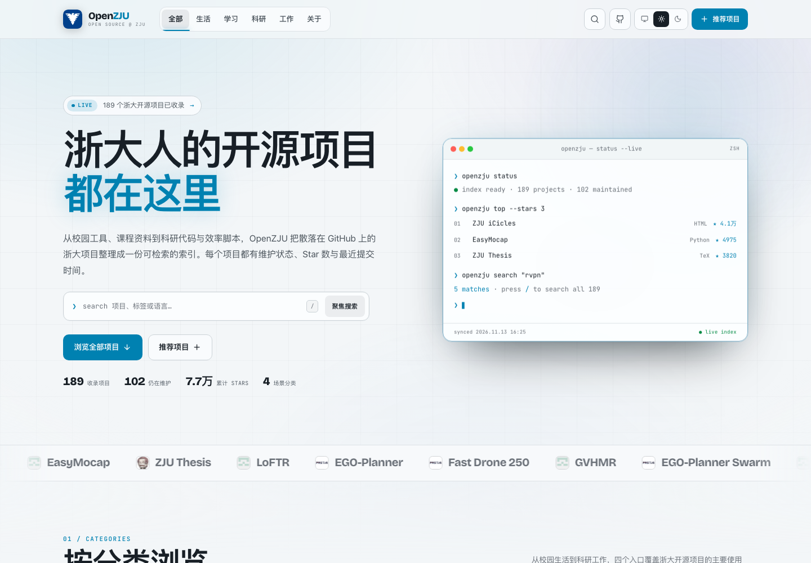
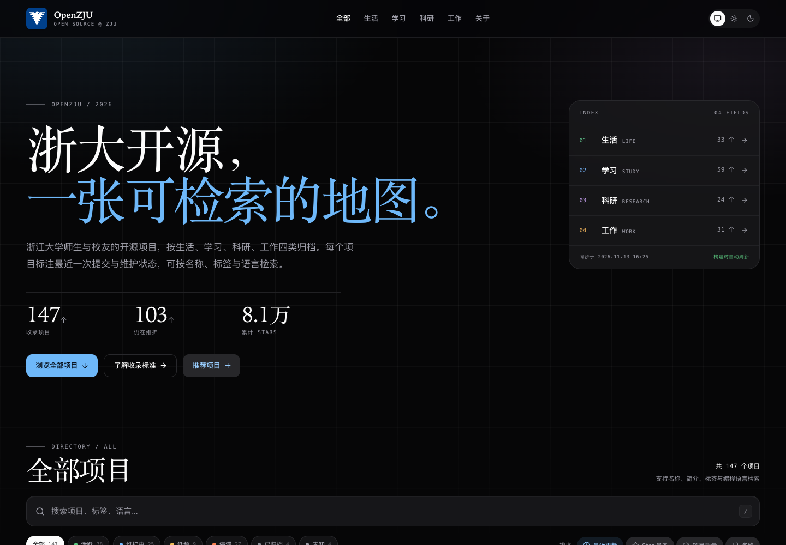
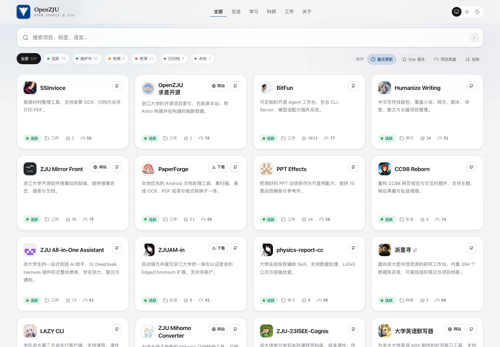
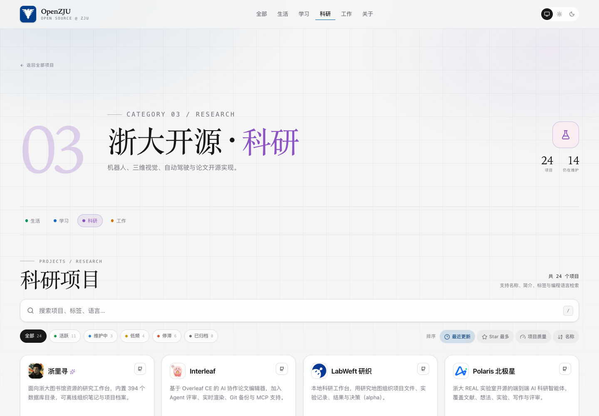
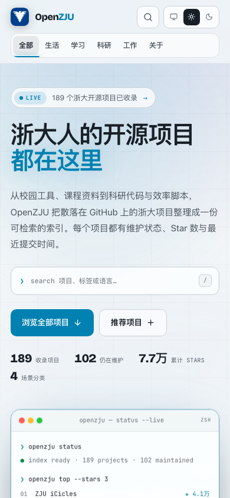

<div align="center">
  
  <h1>OpenZJU</h1>
  <p>一张可检索的浙江大学开源项目地图。</p>

  <p>
    <a href="./LICENSE"></a>
    
    
    
    
  </p>

  <p>
    <a href="./README.en.md">English</a> ·
    <a href="./docs/README.md">文档</a> ·
    <a href="#快速开始">快速开始</a> ·
    <a href="#许可">许可</a>
  </p>
</div>

---

## 为什么做这个

浙江大学每年都会产生大量开源项目：课程资料、科研代码、校园工具、效率脚本、模板与资源集合。它们散落在不同的组织和个人仓库里，生态位经常重叠，也有很多项目已经停止维护。

**OpenZJU** 希望成为一个持续更新的索引：

- 做新项目之前，先看看有没有人已经做过类似的事。
- 使用一个项目之前，先看看它是否仍在维护。
- 寻找课程资料、校园工具或科研代码时，按分类和标签快速筛选。

站点本身不托管代码，也不对项目质量做背书。它只负责整理入口，并把 GitHub 上可观察到的维护状态呈现出来。

## 功能

- **四种分类**：生活、学习、科研、工作。
- **构建时同步**：每次构建读取 GitHub 项目的 Stars、语言、License、归档状态、最近提交时间与最近 90 天提交数；无 GitHub 仓库的脚本项目会显示为「未知」。
- **维护状态**：自动判定「活跃 / 维护中 / 低频 / 停滞 / 已归档」，已归档项目自动沉底。
- **代码质量主导的项目审计**：卡片状态行里的评分按钮展示 0–100 分，点击展开详情；优先使用每日深度静态分析（复杂度、重复率、lint、密钥、依赖漏洞），没有可分析源码时回退到工程信号评分，弹层里附带启发式 AI 风险。
- **静态搜索**：按名称、简介、标签、分类、语言、License 搜索，不依赖服务端。
- **组合筛选**：维护状态筛选、最近更新 / Star / 名称排序，筛选条件会同步到 URL。
- **标签即入口**：点击卡片标签即可按标签搜索。
- **明暗主题**：默认跟随系统，也可手动选择白天或黑夜模式，选择会持久化。
- **Swup 页面过渡**：路由切换无整页白屏，同时保留可访问性、head 更新与滚动行为。
- **响应式布局**：从手机到宽屏的全局滚动与自适应网格。
- **可访问性**：跳过链接、键盘快捷键、焦点管理、状态播报与减少动效支持。
- **自动数据缓存**：GitHub 不可达或触发速率限制时，构建会回退到上一次成功同步的数据；统计数据、审计数据与代码质量数据分别缓存。
- **每日深度分析**：GitHub Actions 每天运行静态分析并自动提交通用代码质量缓存，Vercel 构建保持快速。

## 预览

| 白天模式                                      | 黑夜模式                                     |
| --------------------------------------------- | -------------------------------------------- |
|  |  |

| 项目网格                                     | 分类页                                          |
| -------------------------------------------- | ----------------------------------------------- |
|  |  |

<p align="center">
  
</p>

## 快速开始

### 环境要求

- Node.js **>= 22.23.4**（推荐 24 LTS）
- pnpm **>= 11**

### 本地运行

```bash
pnpm install
cp .env.example .env
pnpm dev
```

打开 `http://localhost:4321`。

`GITHUB_TOKEN` 不是本地开发的必填项。没有 token 时，构建会使用匿名 GitHub API 或已有缓存；配置 token 后可以获得更完整的提交频率数据，并避免匿名速率限制。

### 构建

```bash
pnpm build
```

构建流程是：

1. 运行 `scripts/sync-projects.ts`，从 GitHub 同步仓库状态并写入 `src/generated/repository-stats.json`。
2. 运行 `scripts/sync-audits.ts`，同步工程信号与 OpenSSF Scorecard，并读取 `repository-code-quality.json`，写入 `src/generated/repository-audits.json`。
3. Astro 静态生成首页、四个分类页、关于页、404 页、`robots.txt` 与 sitemap。
4. 输出到 `dist/`。

深度静态分析不在 Vercel 构建里运行。它由 [`.github/workflows/deep-audit.yml`](./.github/workflows/deep-audit.yml) 每天执行，结果自动提交后再触发部署；首次部署后可在 Actions 页面手动运行一次。工具、评分和限制见 [`docs/code-quality.md`](./docs/code-quality.md)。

如果已经在本地同步过，或暂时没有网络，可以跳过网络请求：

```bash
SKIP_GITHUB_SYNC=1 pnpm build
```

## 添加一个项目

项目的基础信息统一存放在 [`src/data/projects.ts`](./src/data/projects.ts)。添加一条记录即可：

```ts
{
  slug: "my-zju-project",
  name: "My ZJU Project",
  description: "一句话说明这个项目解决了什么问题。",
  repo: "owner/repo",
  category: "study",
  tags: ["课程资料", "工具"],
  links: {
    website: "https://example.com",
    download: "https://example.com/download",
  },
}
```

字段说明：

| 字段             | 必填 | 说明                                                     |
| ---------------- | ---- | -------------------------------------------------------- |
| `slug`           | 是   | 全站唯一，小写 kebab-case                                |
| `name`           | 是   | 展示名称                                                 |
| `description`    | 是   | 中文简介，至少 16 个字符                                 |
| `repo`           | 否   | GitHub 仓库，格式为 `owner/name`；无仓库时需提供 `links` |
| `category`       | 是   | `life` / `study` / `research` / `work`                   |
| `tags`           | 是   | 至少一个，建议 2 到 4 个                                 |
| `links.website`  | 否   | 部署网站或项目主页                                       |
| `links.download` | 否   | 下载地址或 Releases 页面                                 |
| `featured`       | 否   | 是否显示编辑推荐标记                                     |

`slug` 必须唯一；提供 `repo` 时也必须唯一。没有 GitHub 仓库的项目也可以收录，但至少要填写 `links.website` 或 `links.download`。数据会在构建时通过 [`validateProjects`](./src/domain/project/project.ts) 校验，重复、缺失字段或非法 URL 会直接让构建失败。

## 维护状态

| 状态   | 判定                       |
| ------ | -------------------------- |
| 活跃   | 默认分支最近 90 天内有提交 |
| 维护中 | 最近一年内有提交           |
| 低频   | 最近一次提交在一至两年前   |
| 停滞   | 超过两年没有提交           |
| 已归档 | GitHub 仓库被维护者归档    |
| 未知   | 暂未获取到仓库活动数据     |

状态只是自动化判断，不代表项目是否适合生产使用，也不构成质量评分。

## 目录结构

```text
.
├── .github/
│   ├── ISSUE_TEMPLATE/          # 推荐新项目的 Issue 表单
│   └── workflows/               # CI、深度分析与部署工作流
├── docs/                        # 架构、数据、设计、部署与开发文档
├── public/                      # favicon、OG 图、manifest
├── scripts/
│   ├── deep-audit/              # 每日深度静态分析脚本
│   ├── sync-audits.ts           # 构建前项目审计同步入口
│   └── sync-projects.ts         # 构建前 GitHub 数据同步入口
├── src/
│   ├── application/             # 应用层：目录聚合、搜索与排序
│   ├── config/                  # 站点配置
│   ├── data/                    # 项目基础数据（唯一数据源）
│   ├── domain/                  # 领域层：项目、分类、维护状态
│   ├── generated/               # 仓库状态、审计与深度代码质量缓存
│   ├── infrastructure/          # 基础设施层：GitHub / OpenSSF API、代码质量缓存
│   ├── pages/                    # Astro 路由页面
│   └── presentation/            # 表现层：Astro 组件、布局、样式、控制器
├── astro.config.mjs
├── biome.json
├── package.json
├── tsconfig.json
└── vercel.json
```

项目采用 DDD + MVC 分层：

- **Domain**：`Project`、`Category`、`RepositoryStats`、维护状态判定，不依赖 Astro 或 Node。
- **Application**：目录组装、统计、搜索、排序，保持纯函数。
- **Infrastructure**：GitHub GraphQL / REST / Atom 同步、缓存读写。
- **Presentation**：Astro 视图、样式与浏览器端控制器。

更多细节见 [`docs/architecture.md`](./docs/architecture.md)。

## 常用命令

| 命令                         | 说明                       |
| ---------------------------- | -------------------------- |
| `pnpm dev`                   | 启动 Astro 开发服务器      |
| `pnpm build`                 | 同步 GitHub 数据并静态构建 |
| `pnpm preview`               | 本地预览构建产物           |
| `pnpm sync:projects`         | 手动同步 GitHub 仓库状态   |
| `pnpm sync:projects:offline` | 只使用本地缓存             |
| `pnpm sync:audits`           | 手动同步项目审计           |
| `pnpm sync:audits:offline`   | 只使用审计缓存             |
| `pnpm deep:prepare`          | 生成深度审计分片           |
| `pnpm deep:analyze`          | 分析一个分片               |
| `pnpm deep:merge`            | 合并深度分析结果           |
| `pnpm check`                 | `astro check` + Biome 检查 |
| `pnpm check:ci`              | CI 使用的严格检查          |
| `pnpm format`                | 使用 Biome 格式化          |
| `pnpm lint`                  | 使用 Biome 做 lint         |
| `pnpm test`                  | 运行 Vitest 单元测试       |

## 构建时 GitHub 同步

同步逻辑位于 [`src/infrastructure/github`](./src/infrastructure/github)：

1. 配置了 `GITHUB_TOKEN` 时，优先使用 GraphQL 批量查询。
2. GraphQL 不可用时，回退到 REST：读取仓库元数据，再读取最近 90 天的提交。
3. REST 提交接口不可用时，尝试 GitHub Atom feed。
4. 任意步骤失败都会使用上一次成功写入的缓存。
5. 结果写入 `src/generated/repository-stats.json`，随仓库提交，作为离线与降级兜底。

同步结束后的统计含义：

- **已更新**：本次成功取到新数据的仓库数。
- **缓存回退**：请求失败、但使用了旧缓存的仓库数。
- **缺失**：请求失败且没有旧缓存、页面上会显示为「未知」的仓库数。
- **请求失败 / 其中限流**：本次发生的仓库级请求错误次数，以及其中由 GitHub 403/429 限流造成的次数。

推荐在本地和部署环境配置 token。匿名 GitHub API 的速率限制较低，不适合频繁构建。审计同步会复用同一个 token，读取 Community Profile、仓库根目录与 `.github`，并尝试获取 OpenSSF Scorecard；审计结果写入 `src/generated/repository-audits.json`，失败时使用上一次缓存。评分方法与局限见 [`docs/audit.md`](./docs/audit.md)。

## 部署到 Vercel

1. 将仓库导入 Vercel，Framework Preset 选择 **Astro**。
2. 设置环境变量：
   - `GITHUB_TOKEN`：GitHub Personal Access Token，仅需读取公开仓库。
   - `SITE_URL`：生产域名，例如 `https://www.openzju.cn`。
   - `PUBLIC_REPOSITORY_URL`：可选，默认指向本仓库，决定页脚与「添加我的项目」Issue 入口。
3. 部署。Vercel 会自动执行 `pnpm build`，构建时刷新 GitHub 数据。
4. 在 Vercel 创建 Deploy Hook，并把地址保存为 GitHub Actions secret `VERCEL_DEPLOY_HOOK_URL`。每日深度分析工作流会在提交代码质量缓存后触发一次重新构建；建议关闭 Vercel Git 自动部署，避免重复构建。

详细步骤与故障排查见 [`docs/deployment.md`](./docs/deployment.md)。

## 文档

- [文档索引](./docs/README.md)
- [架构：DDD + MVC 与构建流程](./docs/architecture.md)
- [数据模型与维护状态](./docs/data-model.md)
- [项目审计与 AI 风险](./docs/audit.md)
- [深度代码质量与每日静态分析](./docs/code-quality.md)
- [静态搜索、筛选与 Swup](./docs/search-and-navigation.md)
- [设计系统与可访问性](./docs/design-system.md)
- [部署与定时重建](./docs/deployment.md)
- [本地开发与代码规范](./docs/development.md)

## 贡献

欢迎补充项目、修正信息、改进界面或完善文档。

- 推荐新项目：使用仓库中的 Issue 模板，或直接修改 `src/data/projects.ts` 后提交 Pull Request。
- 提交前请运行 `pnpm check` 与 `pnpm test`。
- 请遵守学术诚信与项目自身的许可证；课程资料类仓库尤其需要注意版权与隐私。
- 如果你不希望自己的项目被收录，请通过 Issue 或 Pull Request 联系移除。

## 许可

本项目代码以 [GNU General Public License v3.0](./LICENSE) 发布。

项目名称、简介、链接、统计数据、审计与代码质量结果仅用于索引与展示，版权归各自作者所有。收录不代表推荐、审核或保证合规；审计分、代码质量分与 AI 风险标签都是启发式判断，不是项目质量裁决，也不是 SonarQube 官方结果或覆盖率报告；部分自动化脚本可能违反平台规则或学术诚信要求，请自行判断并承担使用后果。本站不是浙江大学官方项目，也不代表学校立场。

## 致谢

感谢所有愿意把课程资料、科研代码与校园工具开源出来的浙大师生与校友。也感谢 Astro、Tailwind CSS、HeroUI、Swup、Lucide、Biome 与 GitHub 提供的开源基础设施。
